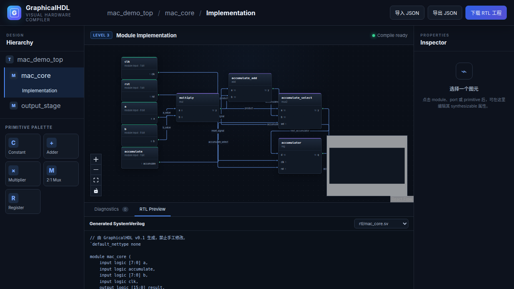

# GraphicalHDL

GraphicalHDL 是一个三层 Graphical HDL editor 和 RTL Compiler。用户在 Web 画布中编辑系统架构、module interface 和 module implementation，系统将权威 JSON 设计编译为 deterministic、可综合的 SystemVerilog 工程。



## 当前版本

v0.1 已打通完整 vertical slice：

- **Level 1 — System Architecture**：top I/O、module instance 和跨 module net。
- **Level 2 — Module Interface**：port 名称、direction、width 和 role。
- **Level 3 — Module Implementation**：`const`、`add`、`mul`、`mux2`、`reg` 及端口级连接。
- 实时 JSON Schema 与 semantic diagnostics，错误可定位到层级和图元。
- `JSON -> normalized IR -> SystemVerilog -> manifest/source map`。
- CLI 与 Web 使用同一个 pure TypeScript Compiler core。
- Verilator lint、Icarus self-checking simulation 和可选 Yosys synthesis gate。

v0.1 限定为 unsigned、静态位宽、单 Clock domain、`posedge`、synchronous active-high reset。Compiler 不会隐式 resize、cast、pipeline 或修正名称。

## 快速开始

要求 Node.js 22+ 和 npm。安装依赖时使用项目内配置的 npmmirror registry：

```bash
cd /home/mmhh/rdma-ji/GraphicalHDL
npm install
npm run preflight
npm run dev
```

浏览器打开 `http://127.0.0.1:5173`。编辑器默认载入 `examples/mac-accumulator/design.json`。

## CLI

```bash
# 只验证，不写文件
npm run cli -- validate examples/mac-accumulator/design.json

# 生成完整 RTL 工程
npm run cli -- compile examples/mac-accumulator/design.json --out build/mac-accumulator

# 检查磁盘生成物是否漂移
npm run cli -- check examples/mac-accumulator/design.json --out build/mac-accumulator
```

生成目录包含：

```text
rtl/*.sv
    每个 module 一个 SystemVerilog 文件
graphicalhdl.f
    RTL source filelist
manifest.json
    semantic hash 和各 artifact SHA-256
report/diagnostics.json
    稳定 diagnostic report
report/source-map.json
    RTL 行范围到 GraphicalHDL 图元的映射
```

## 验证

```bash
npm run generate:check
npm run format:check
npm run lint
npm run typecheck
npm run test
npm run build
npm run example:compile
npm run example:check
npm run rtl:lint
npm run rtl:sim
npm run rtl:synth   # 需要 Yosys
```

Web E2E：

```bash
# 已安装 Playwright Chromium 时
npm run test:e2e

# 使用系统 Chromium 时
PLAYWRIGHT_CHROMIUM_EXECUTABLE_PATH=/snap/bin/chromium npm run test:e2e
```

## 工程结构

```text
schemas/                GraphicalHDL JSON Schema（单一格式事实源）
packages/ir/            raw types、primitive catalog、diagnostic/artifact 类型
packages/compiler/      pure Compiler pipeline 和 SystemVerilog emitter
packages/cli/           CLI 与安全 output writer
apps/web/               React + React Flow 三层 editor
examples/               可直接编译的设计 JSON
tests/                  contract、unit、RTL、Web E2E
verification/           Yosys 等外部 RTL 门禁
scripts/                codegen、preflight 和验证入口
docs/                   IR、primitive、pipeline 和开发文档
build/                  本地生成物；不提交
.cache/                 npm/Playwright cache；不提交
```

## 设计原则

1. JSON 是源码，画布是编辑器，不从像素猜测 RTL。
2. `design` 是硬件语义，`layout` 只保存显示状态。
3. Primitive 具有严格、可测试的 pin 和位宽语义。
4. 生成结果不包含 timestamp、绝对路径或随机 ID。
5. Diagnostic 和 generated source map 都携带稳定图元 ID。
6. 有 error 时不生成半成品 RTL。

进一步阅读：

- [IR 格式](docs/ir-format.md)
- [Primitive 参考](docs/primitive-reference.md)
- [Compiler pipeline](docs/compiler-pipeline.md)
- [开发与验证](docs/development.md)
